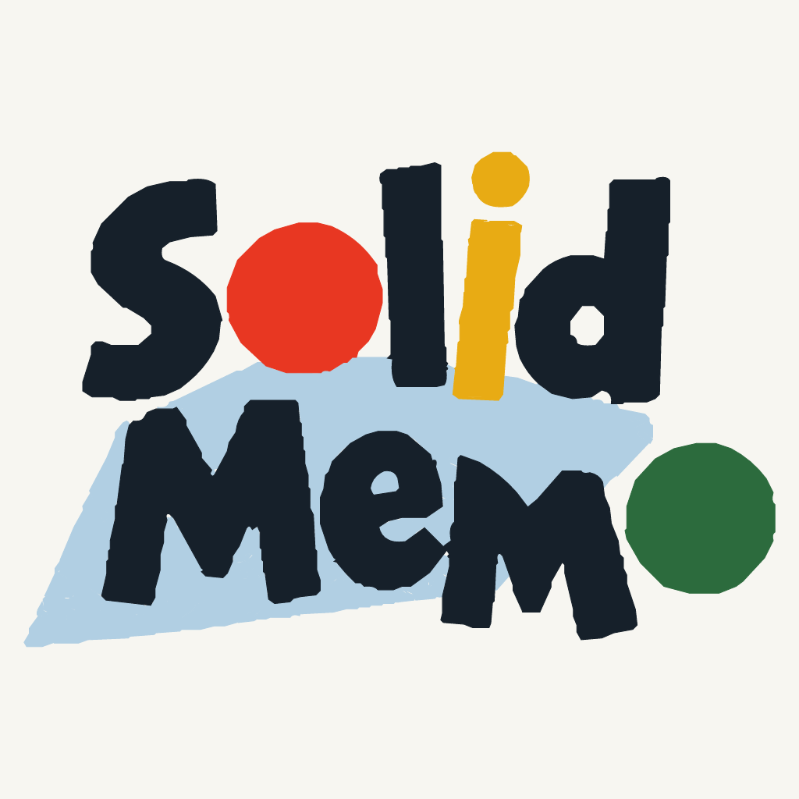

<!-- _class: lead -->
<!-- _paginate: false -->
<!-- _footer: '' -->



# Nine server setups, no server of its own

What a Solid app for everyone learned in production, and what it asks of the ecosystem

<!--
Hi, I'm Anton. I build Solid Memo, a flashcard app that keeps everything in the learner's own pod. You all know what a pod is, so I'll skip that part and spend the time on what you can't get from the specs: what it took to ship a polished app on Solid with no backend at all, what differs between the pod servers we test against, nine setups of five servers, and a short list of things I'd ask of identity providers, servers, libraries and the specs.

Timing: about 21 to 22 minutes of talk, then questions. Slides marked "(skip if short on time)" can go.

Every claim here has a file and line in the public repository, github.com/solid-memo/website. Figures were checked on November 4, 2026, at version 6.29.18; check them again before you give this talk. The slides and notes are CC BY 4.0, at github.com/solid-memo/talks.

(If you aren't Anton: the first-person story is the maintainer's. Tell it as his, or in your own words. For an audience new to Solid, give the other talk, "Build the app, let users keep the data", in 2026-solid-memo.)
-->

---

<!-- _class: phone -->

## Solid Memo

Spaced-repetition flashcards in **your own pod**.

- Static files on GitHub Pages: **no backend, no secret**
- Guest mode, six UI languages, **115** decks and courses
- **1.0.0** on October 13, 2026; **168** releases in all
- Costs **123.75 SEK a year**: the domain


<!--
The app in one slide. You study flashcards, and each card comes back just before you'd forget it, scheduled with FSRS-6 or the classic SM-2.

Why Solid: I wanted to build an app, not run a company. No servers to patch, no database of other people's study history, no password resets, no bill that grows with users. And I wanted to show that Solid can carry a polished app that anyone would use, not only a demo: tested, accessible, translated, documented, stable.

Where it is now: version 6.29.18. 1.0.0 was on October 13, stable from the first release, and semantic-release has cut 168 releases in all, 1.0.0 included. The library has 115 entries, 106 decks and 9 courses, about 19,000 cards. The UI is in English, Swedish, Korean, German, Spanish and French.

The whole bill is the domain, 123.75 Swedish kronor a year, about €11.

(Not to say aloud: the figure is the maintainer's own; the repository says only that the domain is the one cost.)
-->

---

## Where everything lives

<div class="wide">


</div>

<!--
You know this picture. What's particular here: everything the learner's data and login involve goes from the browser straight to the pod and the identity provider.

What solid-memo.com itself serves is only static files: the app, the vocabulary at /ns/vocab/v1.ttl, the SHACL shapes at /ns/shapes/<shape>/v<N>.ttl, the deck library as a DCAT catalog at /decks/index.ttl, and a Client ID Document, clientid.jsonld. GitHub Pages does no content negotiation, so every Turtle address ends in .ttl.

The rest of the talk: logging in with no backend, keeping data in someone else's pod, nine server setups, two patterns worth taking, and what I'd ask of you.
-->

---

<!-- _class: divider -->

# 1. Logging in with no backend

<!--
Part one. A static app is a public client: no secret, one origin, and in our case one redirect URI for every identity provider in the world.
-->

---

## A Client ID Document, written by the build

```typescript
const document = {
  "@context": [OIDC_CONTEXT],
  client_id: clientIdUrl(origin),     // https://solid-memo.com/clientid.jsonld
  redirect_uris: [`${origin}/`],
  scope: "openid offline_access webid",
  grant_types: ["authorization_code", "refresh_token"],
  token_endpoint_auth_method: "none",
  application_type: "web",
};
```

Used only when the provider lists `webid` in `scopes_supported`. Anywhere else (dev, test journeys, a fork without its own domain): dynamic registration.

<!--
The Client ID Document is generated at build time from the CNAME file, so a fork on another domain gets its own, and without a CNAME there is none. This is packages/site/src/clientId.ts, shortened: client_name, client_uri, logo_uri and response_types left out.

The test for whether a provider accepts it is "webid in scopes_supported". That's the de facto signal; there's no explicit one.

Three gaps we hit:
- login.inrupt.com lists webid, but not "none" in token_endpoint_auth_methods_supported, so a public client can't tell whether it may use the document there. A login with it there is untried.
- Caching. CSS fetches the document at each login; Inrupt caches it for a time it doesn't state. So a new redirect URI has to go into the document a release before the app uses it.
- Logout. The Solid-OIDC context defines no post_logout_redirect_uris, so a Client ID Document app can't do RP-initiated logout. Ours forgets the session locally only.

And the client_id URL is public API: providers record consent per client ID, so moving it would ask every learner to consent again.
-->

---

## One redirect URI for every issuer

Every provider gets the same redirect URI and, on solid-memo.com, the same `client_id`.
Only **RFC 9207's `iss`** says which provider an answer came from.

- An answer **without `iss`**, or with another issuer's: refused
- The issuer each tab was sent to is kept **per tab**
- A provider that sends no `iss` **can't be used** to log in
- Parameters the tab never asked for are **stripped** before the library sees them

<!--
This is an OpenID mix-up defense, and it came out of a security fix in late October; the advisory is published as GHSA-vrcx-39mp-3746, and when a login is stopped for safety, the error links to it in the user's language.

The detail: Inrupt's library keeps pending login requests in localStorage, shared by every tab, keeps one that was never answered, and checks iss only against metadata it fetches again from the request's issuer when the answer arrives. So the app now stores the target issuer in sessionStorage before leaving, per tab, and refuses an answer whose iss is missing or different, ignoring a trailing slash.

The cost: one suggested provider, the iGrant.io Data Pod, sends no iss, so it was dropped from the suggestions. Today they are solidcommunity.net, Inrupt PodSpaces and solidweb.me.

The last bullet: Inrupt's handleIncomingRedirect takes any code and state on the URL as a login to finish, and ends the stored session when that fails, so a crafted link logged our users out. The app now marks a tab before it sends it to a provider, and strips those parameters otherwise.
-->

---

## DPoP binds a token to a key, not to a server

The login's fetch sends the user's token **to any address it's given**.

- **A credential gate**: as the user only inside their own storages and the Solid Memo folders they registered; elsewhere, read as no one, and never write
- **`redirect: "error"`** on every credentialed request
- **Signed out** on a 401 only when the session is gone, or on `error="invalid_token"` from the user's own storage or provider

<!--
The app follows links across pods: a deck someone published, a catalog that names documents on another server. The authenticated fetch would send the user's DPoP-bound token to all of them. DPoP stops a stolen token being replayed with another key; it doesn't stop the app making requests as the user to a server it shouldn't trust.

So the data adapters get a gated fetch: as the user inside the profile's pim:storage folders and registered instances, anonymous reads elsewhere, and writes elsewhere refused. Before that fix, a catalog naming a document on another server got requests sent there as the user.

Redirects: Inrupt's sign-in client sends a redirected request that ends in 401 or 403 again to the new address, with fresh credentials, past the gate. It's in our commit log, and I'd like to go through it with the Inrupt team. Now every credentialed request says redirect: "error"; a redirected read is retried as no one, a redirected write is refused.

And 401s: a 401 from someone else's pod used to sign the user out. Now a 401 signs the user out only when the sign-in client has lost the session, or when it carries error="invalid_token" in WWW-Authenticate from the user's own storage or provider. Servers: please send it. A bare 401 can't tell "not here" from "your token is dead".
-->

---

## Behind a seam: a second client

```typescript
export interface SessionClient {
  restore(): Promise<RestoredSession>;
  sessionIssuer(): Promise<string | null>;
  requestIssuer(state: string): Promise<string | null>;
  login(options: LoginOptions): Promise<void>;
  logout(): Promise<void>;
  fetch: typeof globalThis.fetch;
  webId(): string | undefined;
}
```

Inrupt's libraries by default. Behind a build flag, a client with **no Inrupt library**: its login **about 800 lines** on oauth4webapi. The same contract tests for both.

<!--
(Skip if short on time.)

The app reaches the login library only through this interface, seven members, and a boundary check stops anything else importing Inrupt's. Since 6.16.0 there's a second implementation, @solid-memo/solid-memo-client: oauth4webapi, a non-extractable ES256 DPoP key from WebCrypto, kept in IndexedDB since localStorage can't hold a CryptoKey, the access token in memory only, and a refresh token that two tabs never spend at once, under a Web Lock.

A build flag, SOLID_CLIENT=solid-memo-client, picks it, and CI runs the real-server suite with it on each of the five blocking server setups, as jobs that don't block a merge. Inrupt's library stays the default.

One server detail found on the way: the Community Solid Server grants offline_access, so a refresh token, only with prompt=consent. Without it, every reload is a redirect to the provider.

Note sessionIssuer and requestIssuer: with Inrupt's library, the app reads them from its localStorage keys, which a test pins. Library authors: those two would be welcome as API.
-->

---

<!-- _class: divider -->

# 2. Data in someone else's pod

<!--
Part two: what the app keeps in the pod, and how it shares the pod with the user, other apps, and older versions of itself.
-->

---

## Documents by how often they change

```text
solid-memo/main/
  meta.ttl              what this instance is
  catalog.ttl           every deck, DCAT: one GET for the deck list
  decks/<deck>.ttl      a deck's cards: slow churn
  reviews/<deck>.ttl    their review states: fast churn
  history/2026-11.ttl   the answers, one document a month
  digest.ttl            derived facts, each with the ETag it came from
  drafts/  releases/    the Studio's
```

Not a resource per card: Solid has **no batch read**.

<!--
Without a batch read or a query, a resource per card is the N+1 problem: a 3,000-card deck would be 3,000 GETs. So the layout splits by how often things change, not by entity. A deck is one GET, and a study session never rewrites card content. A year of statistics is twelve GETs, whatever the number of decks, and an unchanged month comes back as a 304.

The digest makes a visit cheap: facts the app worked out, each stamped with the ETag of the document it learned them from, used only after a conditional GET answers 304. "A stale digest is never wrong, only slow." On a server with no ETags it keeps nothing.

For the specs: this is the design pressure a missing batch read puts on every app.
-->

---

## Writing with no transactions

- **`If-Match`** on every edit, **`If-None-Match: *`** on every create
- On a **412**, read again and apply the change again, for documents others share: the type index, the catalog
- An answer is an **insert-only PATCH** with no precondition: its subject is unique
- **The order is the transaction**: create-only writes first, the link that names them last

```sparql
INSERT DATA {
<#answer-20261003T081544001Z-p0m2zz> <https://solid-memo.com/ns/vocab/v1.ttl#grade> "1"^^<…#integer> .
};
```

<!--
Optimistic concurrency everywhere. A stale read is refused locally before anything is sent. Weak ETags are never sent in If-Match, and without a strong ETag a write goes unconditional; we'll see which server that is.

Answers are appended without reading: INSERT DATA, no If-Match, since no other writer names that subject. The slide shows one of an answer's triples, with XML Schema's IRI shortened. Every tested server creates the missing month document and keeps concurrent inserts, except one, which comes later.

With no multi-resource transactions, order does the job. Publishing writes the release first and only then links it from the catalog and the draft; a guest's move into a pod registers the copy in the type index last, so a crash leaves an orphan folder, never a half-written deck something points at.

One ask for servers, which costs us a full GET per grade: return the new strong ETag on a successful PATCH. CSS 6, 7 and 8 and Pivot answer a PATCH with 205 and no ETag, Nextcloud sends none on a write, NSS none at all.
-->

---

## Formats that move, data that stays

- **`formatVersion`** on every subject; a **SHACL shape** per class and version, no `sh:targetClass`
- Old formats read **in memory**; the pod rewritten only **when the user agrees**
- **Never over a newer app's data**; others' triples survive
- Terms **never taken back**, shapes **never edited**

<!--
1.0.0 on October 13, then five majors by 6.0.0 on October 22, four of them a new data format. So format versioning had to be real.

Formats 1 and 2 of one class can sit in the same document, which is why the shapes avoid sh:targetClass: every subject would fail one of them. The app picks the shape by rdf:type, formatVersion, absent meaning 1, and the context.

Reading migrates up the chain in memory, with pure, tested steps. Rewriting the pod is a separate format update the user confirms: one conditional write per document, in place, resumable.

An older tab refuses to save over a subject stamped with a newer format than it writes: the error is writtenByNewerApp. And writing replaces only the shape's own predicates, so another app's triples on the same subject survive.

A CI check holds the public contract one promise per line; a line removed without a breaking-change commit fails, and a vocabulary term or published shape can't be removed at all. The vocabulary is at version 1.27 of v1; a breaking change would be a new namespace.
-->

---

## A variant, not a migration

```turtle
<#card-1> a solid-memo:ReviewState ;
    solid-memo:formatVersion 2 ;
    solid-memo:scheduler solid-memo:sm2 ;
    solid-memo:easeFactor 2.5 ; solid-memo:intervalDays 6 ;
    solid-memo:reviewOf <https://pod.example/decks/deck-1.ttl#card-1> .

<#review-3f1c2a9e-…> a solid-memo:ReviewState ;
    solid-memo:formatVersion 1 ;
    solid-memo:scheduler solid-memo:fsrs6 ;
    solid-memo:stability 6.2 ; solid-memo:difficulty 4.93 ;
    solid-memo:reviewOf <https://pod.example/decks/deck-1.ttl#card-1> .
```

<!--
(Skip if short on time.)

When FSRS-6 arrived, the obvious change was review-state format 3. That would have moved every SM-2 state: every pod would need the format update, and every tab opened before the deploy would refuse to save a review.

Instead FSRS-6 state is a second ReviewState beside the SM-2 one, with its own shape, told apart by a fixed value: sh:hasValue solid-memo:fsrs6 on solid-memo:scheduler. Both are written in the same PATCH. An FSRS state counts only while its SM-2 twin has the same lastReviewedAt, so an older app that grades with SM-2 alone leaves it stale, not wrong.

And the open end: any scheduler value other than these two marks the state as another app's. Solid Memo never reads, overwrites or removes it, and only warns. Another SRS app can keep its state in the same document.

This is from the vocabulary's test fixtures, shortened: the dates, the direction and SM-2's repetition count left out.
-->

---

## A good neighbor in a shared pod

- Reads **one** type registration, its own `solid-memo:Instance`
- Registers its decks, cards, review states and answers **for other apps**: the last two in the **private** index only
- Writes registrations **only when asked**, never because it opened
- Follows type index links only on the **WebID's origins or its storages**
- Removes **only what it wrote**, and keeps folders holding other apps' files

<!--
The type index is shared state with the user and other apps, so the app is careful with it.

It reads only its own sm:Instance registration. For other apps it registers dcat:Catalog, sm:Deck, sm:Card, sm:ReviewState and sm:Answer, and sm:Deck again for its drafts. Review states, answers and drafts go in the private index only, even for a publicly registered instance.

It never writes registrations just because an instance was opened: that would fight other editors of the index and add back what the user removed. Writes are read, change, save with If-Match, and re-apply on 412.

Index links are followed only to documents on the WebID's origin, its document's origin or a storage the WebID names. One found elsewhere may be someone else's.

Provisioning differs too: a pod without type indexes is normal on the Community Solid Server, and Inrupt PodSpaces' WebID document is read-only, so the link goes into an extended profile document in the pod.
-->

---

<!-- _class: divider -->

# 3. Nine server setups

<!--
Part three. The app is only as good as the servers it meets, so every change runs against real ones.
-->

---

## The matrix

| Every change: blocks a merge | Weekly and on main: reported, not blocking |
| --- | --- |
| Community Solid Server 7.2.0 and 6.1.0 | Community Solid Server 8.0.0-alpha.3 |
| CSS 7.2.0 with **ACP** in place of WAC | Pivot 1.8.2, solidcommunity.net's server |
| Node Solid Server 6.0.0 and 5.8.8 | Solid-Nextcloud, on Nextcloud 32 |
| | JavaScript Solid Server 0.0.224 |

Real servers in Docker, pinned by digest, lockfile or commit. **About 100 tests** in each.

<!--
Nine setups of five servers: CSS in four of them, counting Pivot, which is CSS 7 with its own components. The five on the left gate every pull request, deploys and Renovate merges. The four on the right run in a separate Interop workflow: weekly, by hand, and on every push to main that touches the app's Solid code. On every pull request they still have to pass a small contract: PUT a document, read it back, find it in ldp:contains at the exact URL, delete it.

Each of them keeps an expected-failures.json: one entry per failing test, with the reason in a sentence. A job fails only on a failure that isn't listed, and reports listed tests that now pass, so they come off the list. JSS has 78 entries, Nextcloud 27. Pivot and the CSS 8 alpha have none: they pass everything.

Planned: CSS 8 becomes blocking at 8.0.0, and CSS 6 goes. The tests are the 26 integration test files in e2e/pod/src, about 104 test cases, each against each server.
-->

---

## Probe, don't assume

```typescript
const CSS: Traits = { etag: true, etagEveryEdit: true, edits: true,
  creations: true, sparqlUpdate: true, n3: true };
const NSS: Traits = { etag: false, etagEveryEdit: false, edits: false,
  creations: true, sparqlUpdate: true, n3: true };

const PINNED: Record<string, Traits> = {
  "css-7": CSS, "css-6": { ...CSS, etagEveryEdit: false },
  "nss-6": NSS, "nss-5": NSS, "css-acp": CSS,
};
```

A test may skip only where **the protocol allows** what the server does. What the app needs is never a reason.

<!--
The tests ask each server instead of assuming: is there an ETag on a read; does it change on each of five edits in a row; is If-Match enforced; is If-None-Match: * enforced; do SPARQL Update and N3 Patch work. The access control's address comes from Link rel=acl, never from appending .acl, and the storage from rel=type.

Why five edits: one edit gave a false positive on CSS 6. Its ETags are built from whole seconds, and an edit that happened to cross into the next second looked like a change.

The results for the blocking servers are pinned in a test, this one. A server release that changes behavior fails loudly, instead of quietly turning skips on or off, and the pin is moved by hand.

The skip rule is the important part. No ETag, If-Match ignored: the protocol allows that, the app copes, the test may skip. No PATCH the app can send, an ACL that can't be written, a lost insert: the test fails.

This is e2e/pod/src/serverTraits.integration.test.ts, folded onto fewer lines.
-->

---

<!-- _class: quiet -->

## What we found: Node Solid Server and CSS

| Server | What it does | What the app does |
| --- | --- | --- |
| NSS 5, 6 | No ETag; `If-Match` ignored | Unconditional edits; reads everything each visit |
| NSS 5, 6 | PATCH: no `.` touching a term (`1.}`, as Inrupt's solid-client writes), at most 100 kB | Its own SPARQL Update; PUT over 64 KiB |
| NSS 5, 6 | `1.0` matched only as `1`; a patched `true` stored as false | Retries a 409; preferences by PUT |
| CSS 6 | ETags from whole seconds | Lives with it; the tests probe five edits |
| CSS 7, in-memory store | Cuts non-ASCII text short after a PATCH (the file store doesn't) | PUTs drafts whole |
| CSS with ACP | 404 for an ACR not written yet: the library sees no ACP | Reads it as an empty ACR |

<!--
The servers that gate CI, and what each one taught us. I'm saying this with gratitude: these are the servers the app runs on.

Node Solid Server: no ETag and no conditional edits, so lost updates are possible there. Its patch parser takes a "." touching a term as the start of a path, which is how @inrupt/solid-client writes every patch, so at first no edit saved there. The table has the rest.

CSS 6 stamps ETags in whole seconds, so two changes in one second look like one; CSS 7 uses milliseconds. CSS's in-memory store, the default dev config most of us test on, truncates a document after a PATCH holding non-ASCII text: as many bytes as there were characters. The file store doesn't, so the browser journeys run on the file store.

On ACP, CSS answers 404 for an Access Control Resource that hasn't been written yet, with a Link that says what it is. Inrupt's library then decides the server has no ACP, and changes nothing. The app turns that 404 into an empty ACR. CSS with ACP is a blocking setup so that this stays tested.
-->

---

<!-- _class: quiet -->

## What we found: the other servers, and a library

| Server or library | What it does |
| --- | --- |
| JSS 0.0.224 | A patched literal loses its language tag: `"…"^^rdf:langString`, which RDF doesn't allow |
| JSS 0.0.224 | Takes ACLs in JSON-LD only: Turtle gets 415 |
| Solid-Nextcloud | `DELETE DATA` deletes **every value** of the subject and predicate |
| Solid-Nextcloud | Every document's `rel=acl` is the **folder's** `.acl` |
| Solid-Nextcloud | `HEAD` answers 204 for a missing resource |
| Pivot, CSS 8 alpha | **Pass everything** |
| @inrupt/solid-client 4 | `getSolidDataset` copies the graph per quad, **O(n²)**: 9 s for 3,010 cards; fetch and parse 50 ms |

<!--
The JavaScript Solid Server has 78 expected failures, from a handful of causes. The biggest, 31 tests: a SPARQL Update PATCH stores a language-tagged literal as a string typed rdf:langString, tag gone, which RDF doesn't allow, so the app's reader refuses the document. For an app in six languages, that's every PATCH that adds a title or a card's text. Also: an extensionless document PUT as Turtle is served as octet-stream, and <> is stored as the container. We run JSS with --public, so its access control isn't tested here. JSS 0.0.223 rewrote PATCH: real deletes and a per-document lock took tests off the list, and the stricter deletes now stop on the tag problem. The Interop job showed both the day it came in.

Solid-Nextcloud: 27. DELETE DATA removes every value of the subject and predicate it names, so moving one deck out of a group took every other deck out with it, and unlinking one deck from the catalog unlinked every other one, another app's too: that's data loss. Every document names the folder's .acl, so sharing one document would change the whole folder; the app leaves a release private there and says so. HEAD says 204 where GET says 404. Also, concurrent PATCHes to one document fail with 500: SQLite refuses concurrent writes.

Pivot, the server behind solidcommunity.net, and the CSS 8 alpha pass everything. Good news.

And one from the client side: @inrupt/solid-client copies the whole graph for every quad when it builds a dataset. Solid Memo builds it in one pass.

Honest caveat: these are recorded in the repository with a test each, not yet filed upstream. That's on the last slide.
-->

---

<!-- _class: divider -->

# 4. Patterns worth taking

<!--
Part four: two patterns I'd take into any Solid app.
-->

---

## The pod is a fetch

```typescript
export function routedFetch({ origin, local, remote }) {
  return (input, init) => {
    const url = input instanceof Request ? input.url : String(input);
    return url.startsWith(origin) ? local(input, init) : remote(input, init);
  };
}
```

- **Guest mode**: a small pod in IndexedDB, at `https://guest.solid-memo.invalid/`
- After login, the study can move into the real pod: **a copy from one URL to another**
- The same pod code again: the Studio's **sandbox**, and a **test double**

<!--
The code is routedFetch.ts with its types left out. Guest mode isn't a localStorage fallback. It's a small Solid pod served as a fetch: GET, HEAD, PUT, DELETE, and PATCH with INSERT DATA and DELETE DATA. It honors If-Match, If-None-Match star and 304s, keeps ldp:contains, marks its root pim:Storage, and answers a PATCH with 205 and no ETag, like CSS. It has no access control on purpose.

The origin is under .invalid, which never resolves.

Because the adapters see one fetch, the real Solid code runs unchanged for guests, and when you accept the offer after login, moving the study into a new instance in your pod is the generic copy: every IRI rebased, SHACL-checked, and registered in the type index only after the copy is verified. Into an instance you already have, it's added deck by deck. Any address still naming the guest origin, in any spelling, stops the copy.

The same local-pod code gives the Studio's sandbox, a fresh pod in memory for each trial, where an author plays a draft as a learner would, and the test double for the access-control contract tests.
-->

---

## Publishing, with no server of mine

1. A **draft** in the author's own pod
2. **`PUT` with `If-None-Match: *`**: `releases/<name>/v2.ttl`, written once
3. **Public read** on that one document: its own `.acl` or `.acr`, nothing else
4. **Linked** from the author's catalog, last

Readers add it **by link**: read as no one, within limits, SHACL-checked, and **the read that passed** is what's imported.

<!--
The Studio writes decks and courses. A draft lives in the author's pod, in the private type index only.

Publishing writes one Turtle document, once. A release carries its own series and publisher, so it needs no index: it's a DCAT dataset that describes its series and the versions before it. Then the one place the app ever changes access control: public read on that document alone, through a fetch that refuses any other origin or any other ACL. Then the catalog link, and the draft marked as released.

On Solid-Nextcloud, where the document's rel=acl is the folder's, the release stays owner-only, with a "Make it public" button and a warning.

Readers: the link is read once, as no one, with no credentials, so the author's server never learns the reader's WebID, within hard limits: 32 MiB, 400,000 triples. Nothing is ever written to the author's host.

Two gaps for the specs. Finding a newer version: the app walks up at most 8 folders looking for the author's catalog. A standard "latest version" link would replace that. And there's no standard way to make one document public on a server that only has folder ACLs.
-->

---

## What I'd ask of you

<div class="cols">
<div>

### Identity providers

- Send **`iss`**, always
- List **`none`** for public clients
- Spell your issuer **one way**

</div>
<div>

### Servers

- A strong **ETag on every write**
- Enforce **`If-Match`**
- Keep literals **as written**
- Delete **only what's named**
- **No redirects** for pod data

</div>
<div>

### Specs and libraries

- A **batch read**
- Client ID Document **caching and logout**
- A **latest version** link
- **Don't send tokens** everywhere

</div>
</div>

<!--
The list, by audience.

Identity providers: send RFC 9207's iss on every authorization response and advertise it: an app with one redirect URL for every provider, as a static app with a Client ID Document has, has no other mix-up defense. List "none" in token_endpoint_auth_methods_supported if you take Client ID Documents from public clients. And write your issuer one way: of the three we suggest, two end in a slash and one doesn't.

Servers: return the new strong ETag on PUT and PATCH, with sub-second resolution, enforce If-Match and If-None-Match star, keep datatypes and language tags as written and compare terms by value, make DELETE DATA delete exactly what it names, keep HEAD in line with GET, don't answer pod requests with redirects, and send error="invalid_token" when a token is dead.

Specs: a batch or multi-resource read; how long a provider may cache a Client ID Document, and post_logout_redirect_uris in the context; a convention for the latest version of something published in a pod; and the trust boundaries for following type index and ACL links.

Libraries: an origin allowlist for the authenticated fetch by default, never follow a redirect with fresh credentials, keep login state per tab, and expose the session's issuer as API.
-->

---

<!-- _class: divider statement -->

## What this proves

A polished app for anyone, built on Solid **by one person**,

tested against **five pod servers in nine setups**, with **no server** of its own,

for **123.75 SEK a year**.

<!--
Back to why I built it. Can Solid carry a polished app that anyone would use? Here's my answer. It works with no account at all, in six languages, on a phone. It's tested against five pod servers in nine setups, and in three browser engines. It's stable from 1.0.0, aims for WCAG 2.2 AA, and is open down to its decisions. And it costs one domain a year, because the users keep their own data.

Solid is ready for this. The rough edges are the ones on the last slide, and every one of them is fixable.
-->

---

<div class="cols join">
<div>

## Join in

- **Try it**: solid-memo.com
- **Read the findings**: a test and a reason for each, in the repository
- **Report a server**: the *Interop report* issue form
- **Take them upstream** with me

</div>
<div>


<span class="muted">solid-memo.com</span>

</div>
<div>


<span class="muted">Sponsor the domain: github.com/sponsors/ixuz</span>

</div>
</div>

<!--
Four ways in.

Try it: scan the first code, press "Try it without logging in", or log in with your own pod.

Read the findings: every server difference in this talk is a test in github.com/solid-memo/website, and every expected failure says why in a sentence.

Report a server: if you run one we don't test, the repository has an Interop report form: server, version, WAC or ACP, and what happened.

Take them upstream: none of these is filed with the server or library projects yet. If you maintain one of them, talk to me today, and let's turn the lists into issues.

And the second code: sponsor the domain. 123.75 kronor a year is the one thing that keeps Solid Memo depending on my wallet.
-->

---

<!-- _class: lead -->
<!-- _footer: '' -->

# Nine setups.<br>No server.

Thank you. Questions?

<span class="muted">Slides: github.com/solid-memo/talks · CC BY 4.0 · Code: github.com/solid-memo/website</span>

<!--
Thank you. Questions?

Questions people may ask, and short answers:
- "Why SPARQL Update and not N3 Patch?" The app writes SPARQL Update INSERT DATA and DELETE DATA, which every tested server takes. The tests also probe N3 Patch on each server, and the blocking ones accept both.
- "Why not one resource per card?" No batch read: a deck would be thousands of GETs. See the layout slide.
- "Offline?" No service worker: the app works while it's open. Nothing runs while it's closed, so there are no push reminders either.
- "Why keep Inrupt's library as the default?" It's the most used and best tested. The second client is there to prove the seam holds and to have a way out; it runs the full suite as an advisory job.
- "What if a provider closes?" The data is RDF in documented formats, with the vocabulary and shapes published, so it can be copied to another pod.
- "Bus factor?" One maintainer. GOVERNANCE.md says what happens to the organization and the domain if I step away: the vocabulary and decks stay served for at least three years.
-->
