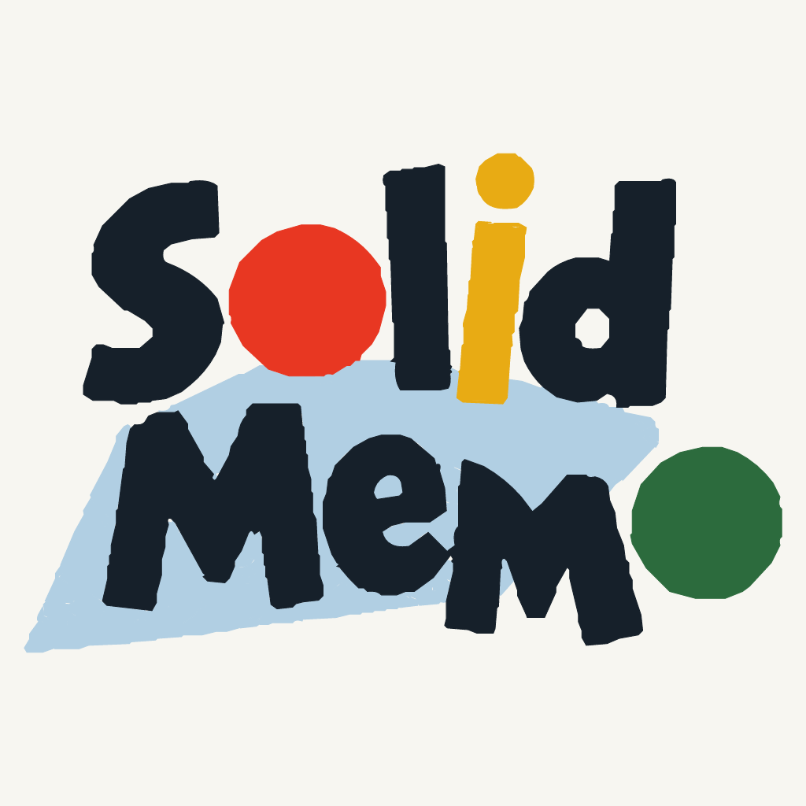
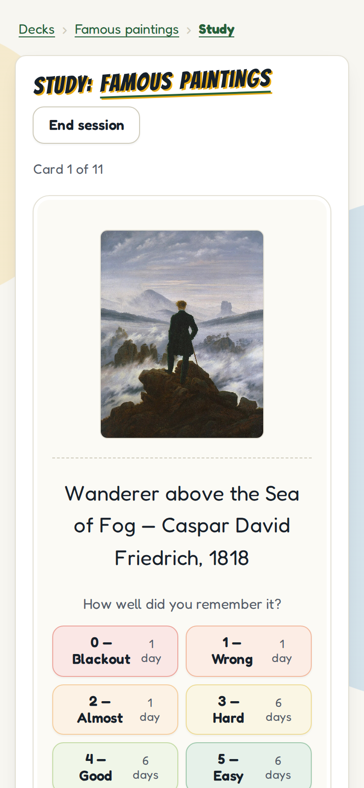
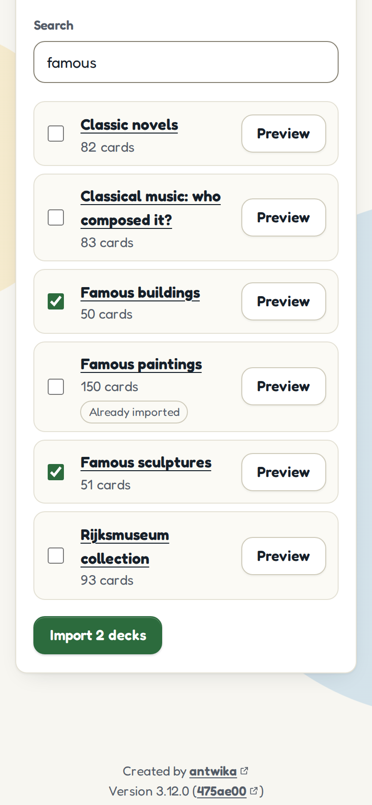
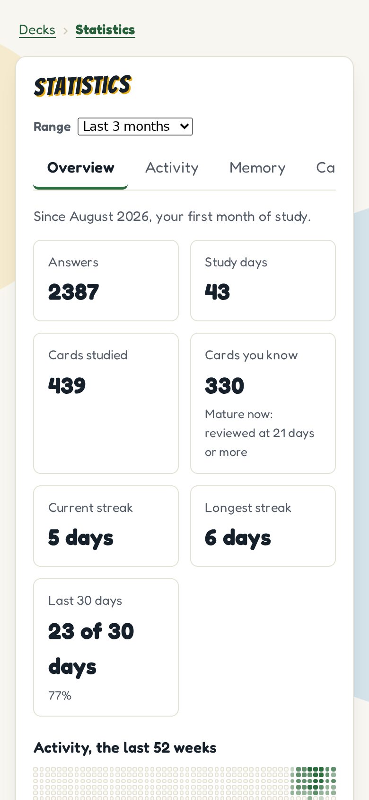
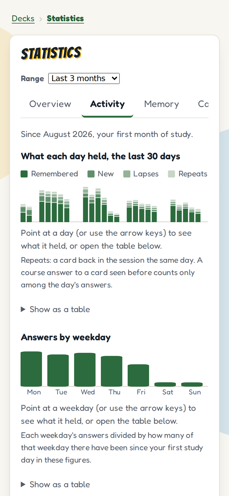
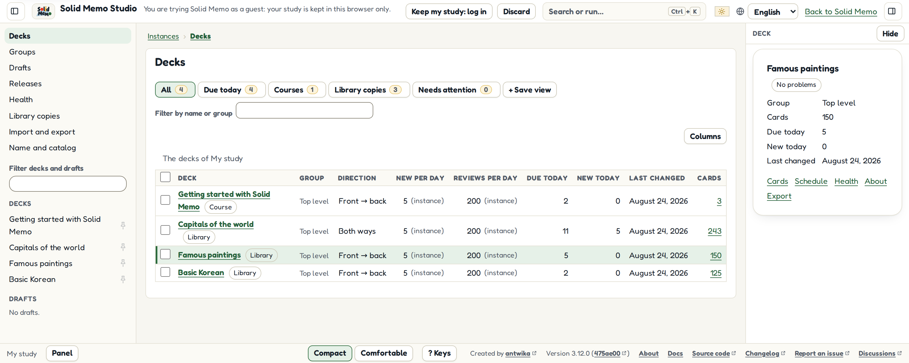
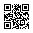
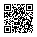

<!-- _class: lead -->
<!-- _paginate: false -->
<!-- _footer: '' -->



# Build the app, let users keep the data

Solid Memo: flashcards that live in your own pod

<!--
Hi, I'm Anton. For the next 40 minutes: a flashcard app, why I built it the way I did, and what it shows about building apps on Solid.

The tagline under the title is the app's own: "Spaced-repetition flashcards that live in your own Solid Pod." By the end you'll know what each word in it means.

Everything in this talk is open, at github.com/solid-memo/talks: the slides and these notes under CC BY 4.0, the app's screenshots and logo under MIT.

(If you aren't Anton: the first-person story in these notes is the maintainer's. Tell it as his, or in your own words. Check the figures the notes mark before the talk: they were true on October 22, 2026.)
-->

---

## I wanted to build an app, not run a company

- A server to rent, patch and watch
- A database of other people's data, and its backups
- Accounts, passwords, password resets
- A privacy policy, and the duty to keep it
- A bill every month, whether anyone uses it or not

<!--
(Tell this in your own words. This is the story the talk hangs on.)

I like building apps. What I don't want is everything that comes with running one: servers to patch at night, a database full of other people's study history, backups, password resets, and the legal weight of holding personal data. Plus a bill that keeps coming even if nobody uses the app.

For a hobby project, that's the point where most of us give up, or put it behind a subscription.

So the question I started with: can I build a real app and skip all of that?
-->

---

## I also wanted to prove something

Solid is often shown in demos and prototypes.

*Can it carry a polished app that anyone would use?*

One the Solid project can point to.

<!--
(Your own words again.)

The second reason. Solid has been around for years, and it's usually shown as a demo or a research prototype. I wanted to build something polished enough that the Solid project could point to it and say: this is what it looks like when it's done properly.

So the bar wasn't "it works". The bar was: tested, accessible, translated, documented, stable. You'll see the evidence later.
-->

---

## For anyone who wants to learn

The app shows each card again **just before you would forget it**.

A day, then a few days, then weeks. A few minutes a day are enough.

Not for Solid people: for a student, a traveler learning Korean, someone studying for a driving test.

<!--
Spaced repetition in one breath: you study flashcards, and each card comes back just before you'd forget it. The better you remember a card, the longer it waits: a day, then a few days, then weeks. A card you forgot comes back soon.

The audience matters. Solid Memo isn't a tool for Solid developers. It's for anyone who wants to remember what they learn. If Solid is going to be a showcase, it has to work for people who've never heard of it.

(The wording here is the app's own: README and the About page.)
-->

---

<!-- _class: divider -->

## Three promises, one bar

1. **No server of its own**, and almost no bill
2. **Free**, for anyone who wants to learn
3. **Open**, from the code to the decisions

All held to a showcase's standard.

<!--
Here's the map of the talk. Three promises.

One: no server of my own, and almost no bill. You'll see the bill: it's one line.
Two: free, for anyone who wants to learn.
Three: open, the code, the data formats and how decisions are made.

And all three are held to a showcase standard. That's the fourth part: the proof.
-->

---

<!-- _class: divider -->

# 1. No server of its own

<!--
Part one. To see how an app can have no server, you need to know what a Solid pod is. Five minutes on that.
-->

---

## What a Solid pod is

> Your own online storage, run by a pod provider you choose, or by yourself. Apps that follow the Solid standards keep your data there, and **you decide who may read it.**

Solid is a set of open specifications from the W3C community for storing your data apart from the apps that use it.

<!--
The definition is from Solid Memo's user guide.

Think of it as a personal data folder on the web that any app following the Solid standards can use, with your permission. You pick where it lives: a provider such as solidcommunity.net or Inrupt's, or your own server.

Solid is the set of specifications, started by Tim Berners-Lee. You don't need to know them to follow this talk; the next slide shows what matters.
-->

---

## Apps and data, apart

<div class="wide">


</div>

<!--
The key idea. On the left, apps. On the right, pods. The app is just a web page. It doesn't store your data: it reads and writes your pod directly from your browser.

Logging in: you type your WebID, a web address that names you. The app reads your profile, finds your identity provider, and sends you there to log in, with Solid-OIDC, which is OpenID Connect plus DPoP, which ties each token to a key in your browser. You type your password on your provider's own page. Solid Memo never sees it, and there's no sign-up form.

Because the data isn't in the app, another app can read the same pod. And when you stop using the app, your history stays where it is.
-->

---

## One card, as linked data

```turtle
@prefix solid-memo: <https://solid-memo.com/ns/vocab/v1.ttl#> .
@prefix dcterms:    <http://purl.org/dc/terms/> .
@prefix xsd:        <http://www.w3.org/2001/XMLSchema#> .

<#croatia>
    a solid-memo:Card ;
    solid-memo:formatVersion 6 ;
    solid-memo:frontLabel "Country or territory"@en , "Land eller territorium"@sv ;
    solid-memo:backLabel "Capital"@en , "Huvudstad"@sv ;
    dcterms:created "2026-09-22T10:40:42.499Z"^^xsd:dateTime ;
    solid-memo:back "Zagreb"@en , "Zagreb"@sv ;
    solid-memo:front "Croatia"@en , "Kroatien"@sv .
```

<span class="muted">From the deck Capitals of the world, version 3, at solid-memo.com/decks/</span>

<!--
This is a real card, from the deck Capitals of the world. Shortened only: each pair of languages is on one line, and only the prefixes this card uses are kept.

The format is Turtle, a plain-text way to write RDF, the W3C's model for linked data, where every statement is a subject, a property and a value.

Three things to notice. First, it's text you can read. Second, every word with a colon is a web address: solid-memo:Card is defined at solid-memo.com/ns/vocab. Third, every value has a language tag, so one card holds every language.

This isn't a row in my database. It's a document on the web, and any RDF tool can read it. The vocabulary and the SHACL shapes that describe valid data are published too.
-->

---

## What Solid Memo doesn't run

<div class="cols">
<div>

### A typical app

- Servers, rented and patched
- A database, and its backups
- Accounts and password resets
- Personal data, and the duty to guard it
- Monitoring, on call

</div>
<div>

### Solid Memo

- Static files, on GitHub Pages
- No database: your pod holds your data
- No accounts: your provider has them
- No analytics, no cookies, no tracking
- A domain

</div>
</div>

<!--
The two columns side by side.

Solid Memo builds to plain static files with no server-side code. It's hosted on GitHub Pages and deployed by CI, one released version at a time.

The privacy page says it in one sentence: Solid Memo has no server of its own and no accounts. The app has no analytics, sets no cookies and does not track you.

To be precise, because someone will ask: your browser does talk to servers. GitHub Pages serves the app, your pod and your login provider are servers, and pictures on cards come from hosts such as Wikimedia. They just aren't mine, and none of them gets a copy of your study.
-->

---

<!-- _class: big -->

## What it costs to run

<div class="figure">123.75 SEK</div>

a year, for the domain. Nothing else. *About 10 SEK a month.*

<!--
This is the whole bill: 123.75 Swedish kronor a year, for solid-memo.com. That's about 10 kronor a month, roughly €11 a year (check the exchange rate before you say it).

Everything else costs nothing because the repository is public: the code on GitHub, CI on GitHub Actions, hosting on GitHub Pages, the archive at Zenodo and Software Heritage.

I pay the domain myself, so the project isn't self-sufficient yet. I'll come back to that at the end.
-->

---

## Costs that don't grow

Each learner brings their **own storage**.

A thousand more learners: still 123.75 SEK a year.

No users at all: still 123.75 SEK a year.

<!--
This is the part I find most interesting as a developer.

In a normal app, cost grows with users: more storage, more database, more backups. Here, each learner brings their own storage, their pod. The app is the same static files whether ten people use it or ten thousand.

And the other way around: if nobody uses it for a year, it costs the same. There's nothing to keep running, nothing to shut down, and no data left behind to look after.
-->

---

## The honest trade-offs

- **Learners need a pod.** So you can start as a guest, in the browser, and move into a pod later.
- **Pod servers differ.** So the app is tested against nine of them.
- **Nothing runs while the app is closed.** No push reminders: due cards wait for you.
- **A young ecosystem.** Fewer providers, fewer libraries, more to learn.

<!--
It isn't free of trade-offs, and you should hear them from me.

A learner needs a pod. That's the biggest hurdle, so the app has a guest mode, which I'll show in a moment.

Solid is a standard, but servers implement it differently. One gives no ETags, another builds them from whole seconds. So the tests ask each server rather than assume.

With no server of its own, nothing can nudge you while the app is closed: no push notifications, no email reminders.

And the ecosystem is young. You'll write more yourself than you would with a typical stack.
-->

---

<!-- _class: divider -->

# 2. Free, for anyone who wants to learn

<!--
Part two: what the app is like for a learner. Screenshots, from phones, since that's where most people study.
-->

---

<!-- _class: phone -->

## No account needed to start

**Try it without logging in.** Study as a guest, and what you learn is kept in this browser.

Log in later, and move it into your own pod.


<!--
The first screen a newcomer sees has a button: Try it without logging in. No account, no pod, nothing to sign.

Under the hood, the guest gets a small Solid pod emulated in the browser, in IndexedDB. The app talks to it exactly as it talks to a real pod server, so the deck library, studying, statistics and preferences all work the same for guests. Only publishing a deck from the Studio needs a real pod.

When you log in, the app offers to move what you studied into your own pod.

You can try it now, on your phone: solid-memo.com.
-->

---

<!-- _class: phone -->

## Studying

A card's front, then its back. *How well did you remember it?*

Scheduled with **FSRS-6** by default, or the classic **SM-2**, shown here.



<!--
In a session you see the front, recall the answer, turn the card, and grade yourself.

Two schedulers. FSRS-6, the Free Spaced Repetition Scheduler, by Jarrett Ye and the Open Spaced Repetition project, is the default. It picks the day your chance of remembering drops to 90%, and you can tune that. SM-2 is the classic algorithm from SuperMemo, 1990. You can switch in the preferences, and FSRS replays your past answers, so you don't start from zero.

This screenshot shows SM-2's scale, 0 to 5. Under FSRS-6, the default, you get four buttons: Again, Hard, Good, Easy.

Even that choice is linked data in your pod, not a setting on a server.
-->

---

<!-- _class: phone -->

## From paintings to Vim to Korean

**110** in the library: 105 decks and 5 courses.

The app speaks **six languages**: English, Swedish, Korean, German, Spanish and French.



<!--
The library, as of this talk: 110 entries, 105 flashcard decks and 5 courses. Check the number again before you give the talk; it grows.

The range is the point. HTTP status codes and Vim commands. The brightest stars and the periodic table. Famous paintings and the Rijksmuseum collection. Everyday Korean phrases, chess openings, organs of the human body, Eurovision winners.

The app is in six languages (check again before the talk), and every library deck's newest version has its title and description in all six. Arabic decks show their text right to left.

Each deck says where it comes from and under which license it can be reused. Most are CC0, CC BY-SA or CC BY.
-->

---

<!-- _class: phone -->

## Courses

A little theory, then questions.

Every question you answer **becomes a card** in your own deck.

From *Getting started with Solid Memo* to *Swedish Driving License B: Theory*.


<!--
Courses are chapters of short steps: a bit of theory, then multiple-choice questions, and a review at the end of each chapter.

The twist: every question becomes a card in your deck, so when you finish the course, you keep studying it.

The five courses now: Getting started with Solid Memo, which every newcomer is offered; Korean at the Table; Solid fundamentals; the Standard for Public Code; and Swedish Driving License B: Theory. Check the list again before the talk; it grows.

A course isn't a new kind of thing in the pod. It's a library release with an outline.
-->

---

<!-- _class: phone two -->

## Your progress, worked out in your browser

Streaks, answers, what you know.

All from your own pod. *Nothing is sent anywhere.*

 

<!--
There's a strip above the deck list with today's streak and answers, and a statistics page with an overview, activity, memory and cards.

Every figure is worked out in the browser from the answer log in your pod. There's no analytics server, because Solid Memo has no server of its own. You can also download your answers as a CSV.

That's what owning your data means in practice: the app reads your history, and so can anything else you allow.
-->

---

## Anyone includes everyone

- Aims for **WCAG 2.2, level AA**
- Every screen the **user journeys** visit, checked by **axe**, light and dark
- Made for the **keyboard** alone
- Four palettes, high contrast and color-blind friendly among them
- Text up to 1.5×, reduced motion, right-to-left text

<span class="muted">An aim, not a claim: the gaps are listed in the docs.</span>

<!--
Free for anyone means usable by anyone.

The aim is WCAG 2.2 at level AA. It's an aim, not a claim of conformance: there's been no full audit, and there's no recorded screen-reader pass yet. The docs list the gaps.

What is checked: the user journeys run axe on every screen a step ends on, in light and dark, on desktop and on a phone, and a violation fails the build. The list of allowed exceptions is empty.

(Check these figures again before the talk.) There are four palettes, including high contrast at 7:1 and a color-blind friendly one, four text sizes, reduced motion, and every text is marked with its language, so Arabic reads right to left.
-->

---

<!-- _class: divider -->

# 3. Open

<!--
Part three: open. Not only the code.
-->

---

## Open source, and open about how it's run

- Code under the **MIT** license, every file marked (REUSE)
- Committed to the **Standard for Public Code**
- Assessed against it in the open: 41 of 46 MUSTs, 36 of 51 SHOULDs
- The gaps written down, with what's planned

<span class="muted">Assessed, not certified: October 18, 2026, at version 3.11.0.</span>

<!--
The code is MIT, and every file says who holds the copyright and under which license, checked with the REUSE tool.

The project has committed to the Standard for Public Code, an open standard, from the Foundation for Public Code, for code that public organizations can share and reuse. Its assessment is published in the repository: 41 of 46 MUSTs and 36 of 51 SHOULDs on October 18, 2026, at version 3.11.0. Check for a newer assessment before the talk. It's my own assessment, not a certification.

The gaps are written down too. The biggest is honest and simple: with one maintainer, nobody else reviews my pull requests.
-->

---

## Every decision in writing, in public

- Issues, discussions and pull requests are **the** channels
- A decision exists only once it is **written there**
- Every commit says **why**
- Two exceptions, both private: **security** reports and **code of conduct** reports

<!--
How the project talks. Everything happens in writing, in public: issues, GitHub Discussions and pull requests. If someone messages me privately, I answer by pointing to the public channel.

A decision exists only once it's written in an issue, a discussion or a pull request, and a decision that changes the code is in the message of the commit that makes it. That's Conventional Commits with a body that says why.

There are exactly two exceptions, and both are confidential by nature: security vulnerabilities and code of conduct reports.
-->

---

## Open data, for other Solid apps

- A vocabulary for spaced repetition, at **solid-memo.com/ns/**
- **SHACL shapes** for what valid data looks like, version by version
- A deck library as a **DCAT** catalog, each deck under its own open license

Build an app that reads the same pod. *Your users will thank you.*

<!--
Open source is half of it. The data has to be open too, or "you own your data" means "you own a file nobody else can read".

No existing vocabulary covered spaced repetition, so Solid Memo defines one, published at solid-memo.com/ns/vocab. SHACL shapes describe what valid data looks like, one per kind of data and per format version. The app uses them to check data and to generate code.

The deck library is a DCAT catalog, the W3C's vocabulary for data catalogs, and each deck states its license.

If you build a Solid app, you can read the same pods: a learner's cards, schedule and history.
-->

---

<!-- _class: quiet -->

## Studio: writing decks and courses

Write a deck or a course, check it against every rule, preview it, play it as a learner would, and **publish it in your own pod**.



<!--
Authors write in Solid Memo Studio, a second app in the same page, at solid-memo.com/#/studio.

A draft lives in your pod. You write it, check it against every rule the library holds a release to, preview it as the library will list it, play it in a sandbox as learners will, and compare it with the version before.

Then you publish it in your own pod, where anyone can read it, and a learner adds it by its link. Or you save it as a file and propose it for the library.

So even publishing a deck needs no server of mine.
-->

---

## Built to outlast its maintainer

- A **DOI** at Zenodo for every release
- The source preserved in **Software Heritage**
- A written plan for the **domain** if the maintainer steps away
- What other people's data points at, kept online for at least three years after

<!--
If you're going to point at a project as a showcase, it should still be there in five years.

Every release gets a DOI at Zenodo, and the source is preserved in Software Heritage.

The domain matters more than you'd think: people's pods hold data that points at solid-memo.com/ns and /decks. GOVERNANCE.md says what happens if I step away: the organization and the domain go to an active co-maintainer, or if there's none, the repository is archived and I keep the domain renewed, with the vocabulary and the decks still served, for at least three years.
-->

---

<!-- _class: divider -->

# 4. The proof

<!--
Three promises made. Now, how do you know they hold up? This is the showcase part: the evidence.
-->

---

## Works with your pod, whoever hosts it

Tested against **nine** pod server setups, real servers in Docker:

| Every pull request | Weekly, and when main's code changes |
| --- | --- |
| Community Solid Server 6 and 7 | Community Solid Server 8 (alpha) |
| CSS 7 with ACP | Pivot (solidcommunity.net) |
| Node Solid Server 5 and 6 | Nextcloud with Solid |
| | JavaScript Solid Server |

<!--
Solid is a standard, and the app is only as good as the servers it meets. So every pull request runs the full suite against five real servers in Docker: Community Solid Server 6 and 7, CSS 7 with Access Control Policies instead of Web Access Control, and Node Solid Server 5 and 6. Those five block a merge.

Four more are advisory: CSS 8 alpha, Pivot, which is the server behind solidcommunity.net, Nextcloud with its Solid app, and the JavaScript Solid Server. They get a start-up check on every pull request, and the full suite weekly and whenever a push to main changes the app's code. Their failures are reported, not a gate.

Every server is pinned: the Community Solid Server images by digest, the others built in the repository from a lockfile or a commit, on base images pinned by digest.

Check the number of server setups again before the talk.
-->

---

## Tested like a person uses it

- **User journeys**: a browser clicks through the app, step by step
- In **Chromium**; logging in and guest study also in **Firefox**, **WebKit** and on a **phone**
- On a fresh account and pod, on a real Solid server
- **No retries**: a flaky test is fixed, not re-run
- The report is public: **journeys.solid-memo.com**

<!--
Unit tests aren't enough for an app like this, so there are user journeys: Playwright drives a real browser through the app as a person would, against a real Community Solid Server, with a fresh account and pod each time.

All of them run in Chromium. The ones about logging in, guest storage and reloading also run in Firefox, WebKit and on an iPhone-sized phone.

No retries. If a journey is flaky, it gets fixed.

And you can open the report yourself at journeys.solid-memo.com and replay every click of the release you're using.
-->

---

## Every line covered

- **100% coverage**, per package: statements, branches, functions, lines
- Unreachable code is **removed**, not excluded
- **Boundaries** between layers, checked on every change
- A limit on how complex a function may be

<span class="muted">Coverage doesn't prove the code right. It proves none of it goes untested.</span>

<!--
Every package has 100% coverage of statements, branches, functions and lines, and each package's own tests cover its own code. The test run fails below that.

Code that can't be reached is removed, not excluded, and so is code only the tests use.

The layers have rules about who may import whom, and a check enforces them on every change. Biome caps cognitive complexity.

To be honest about what this means: coverage doesn't mean bug-free. It means nothing ships without a test running it. The real servers and the journeys are what catch the rest.
-->

---

## Stable, and says when it isn't

- **1.0.0** from the first release, on October 13, 2026
- **Semantic versioning**: a change that breaks data is a new major version
- Every promise to other apps is **written down**, one per line
- A vocabulary term is **never taken back**; a published shape or deck version is **never edited**

<!--
Solid Memo was stable from its first release, 1.0.0, on October 13, 2026. Versions and the changelog are written by semantic-release from the commit messages.

Stable here doesn't mean nothing changes. It means a change that breaks the data formats is declared, and gets a new major version. Every promise to other apps, the formats, the pod layout, the routes, is written down in the repository, one per line, and CI fails if a line disappears without a commit saying it's breaking.

And what's published stays: a vocabulary term is never taken back, a shape or a deck version is never edited. Other people's data points at those addresses.
-->

---

<!-- _class: divider statement -->

## What this proves

A polished app for anyone, built on Solid **by one person**,

with **no server** of its own, for **123.75 SEK a year**.

<!--
Back to the question from the start: can Solid carry a polished app that anyone would use?

Here's my answer. One person built it. A learner can start with no account, in six languages, on a phone. It's tested against nine pod server setups, in three browser engines and on a phone, and it's stable, accessible by design, and open down to its decisions.

And it costs 123.75 kronor a year, because the users keep their own data.
-->

---

<div class="cols join">
<div>

## Join in

- **Try it**: solid-memo.com
- **Write a deck**: start with the course *Getting started*, then the Studio
- **Contribute** on GitHub
- **Build your own** app with no server

</div>
<div>



<span class="muted">solid-memo.com</span>

</div>
<div>



<span class="muted">Sponsor the domain: github.com/sponsors/ixuz</span>

</div>
</div>

<!--
Four ways in.

Try it: scan the first code. Press "Try it without logging in" and you're studying in seconds.

Write a deck: take the Getting started course, then open the Studio.

Contribute: issues labeled good first issue, translations, decks, and interop reports from pod servers I don't test yet. Everything is at github.com/solid-memo.

Or build your own app the same way: static files, the user's pod, no server.

(Before the talk, check that the sponsor page answers.)

And the second code: sponsor the domain. 123.75 kronor a year is the one thing that keeps Solid Memo depending on my wallet. Sponsoring it makes the app cost its maintainer nothing.
-->

---

<!-- _class: lead -->
<!-- _footer: '' -->

# Build the app.<br>Let users keep the data.

Thank you. Questions?

<span class="muted">Slides: solid-memo.github.io/talks · CC BY 4.0</span>

<!--
That's the whole idea in one line: build the app, let users keep the data.

Thank you. Questions?

Questions people tend to ask, and short answers:
- "So there are servers after all?" Yes: GitHub Pages, your pod, your login provider. None of them is mine, and none keeps a copy of your study.
- "What if my pod provider closes?" Your data is RDF in open formats. Copy it to another pod, and the app works there too.
- "Offline? Reminders?" No service worker and no push yet: the app works while it's open.
- "Why not just localStorage?" Because then the data is stuck in one browser. Guest mode is exactly that, and it offers to move into a pod.
- "Bus factor?" One maintainer, no funding. There's a written plan for stepping away, in GOVERNANCE.md.
-->
